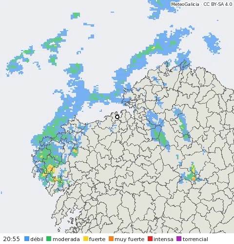
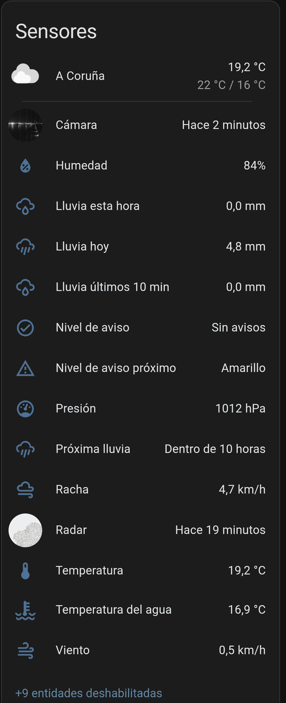
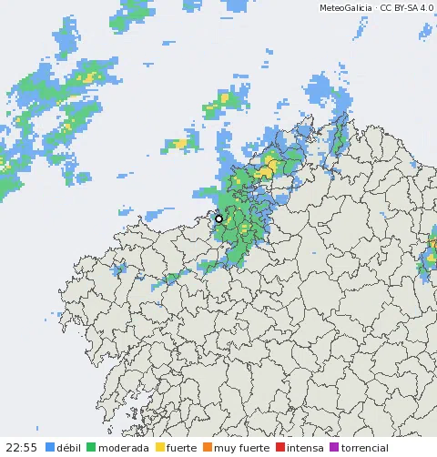
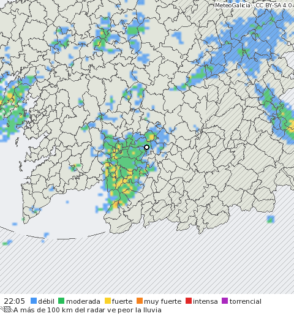
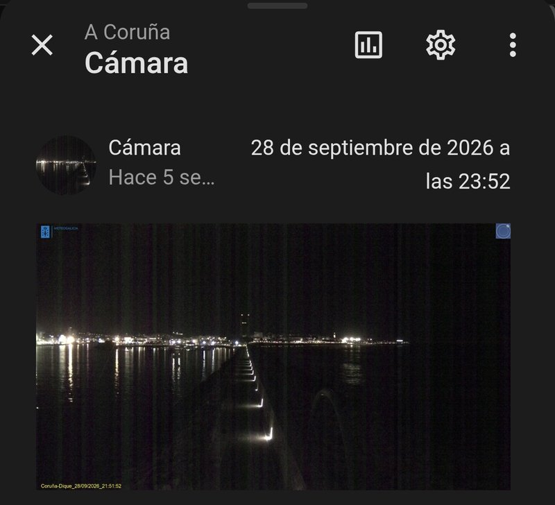

# MeteoGal

[](https://hacs.xyz)
[](https://github.com/iago-veiga/ha-meteogal/releases)
[](https://github.com/iago-veiga/ha-meteogal/actions/workflows/tests.yml)
[](https://github.com/iago-veiga/ha-meteogal/actions/workflows/hacs.yml)
[](https://github.com/iago-veiga/ha-meteogal/actions/workflows/hassfest.yml)
[](LICENSE)

Integración personalizada de Home Assistant con los datos de [MeteoGalicia](https://www.meteogalicia.gal) para cualquier concello de Galicia: previsión, avisos, radar, estaciones y cámaras.

Funciona **sin clave**, con los servicios públicos de MeteoGalicia. Si quieres más detalle, como la lluvia y el viento por hora, puedes añadir una [clave de MeteoSIX](#clave-de-meteosix-opcional), gratuita y opcional.

[](https://my.home-assistant.io/redirect/hacs_repository/?owner=iago-veiga&repository=ha-meteogal&category=integration)



## Para qué sirve

- Ver el tiempo de tu concello con la previsión oficial de MeteoGalicia, hecha concello a concello.
- Enterarte de los avisos de MeteoGalicia (amarillo, naranja, rojo) en cuanto se emiten y automatizar con ellos: cerrar toldos con viento, avisar al móvil.
- Ver llegar la lluvia en el radar, sin salir de Home Assistant.
- Usar lo medido en la estación más cercana: no regar si ya llovió, temperatura del agua en el puerto, heladas.
- Con clave de MeteoSIX, saber cuántos litros van a caer esta hora y cuándo empieza a llover.

## Contenido

- [Requisitos](#requisitos), [instalación](#instalación) y [configuración](#configuración), con [todas las opciones](#todas-las-opciones)
- [Qué ofrece](#qué-ofrece): [el tiempo](#el-tiempo), [avisos](#avisos), [radar](#radar), [estación](#estación), [cámara](#cámara), [MeteoSIX](#clave-de-meteosix-opcional) y [acciones](#acciones)
- [Ejemplos](#ejemplos) y [cada cuánto se actualiza](#cada-cuánto-se-actualiza)
- [Limitaciones](#limitaciones), [problemas frecuentes](#problemas-frecuentes) e [informar de un problema](#informar-de-un-problema)
- [Quitar MeteoGal](#quitar-meteogal)
- [Documentación técnica](#documentación-técnica)

## Requisitos

- Home Assistant 2025.11 o posterior.
- Una ubicación en Galicia: MeteoGalicia no da datos de otros lugares.
- Conexión a internet: los datos se consultan a MeteoGalicia.
- Opcional: una [clave de MeteoSIX](#clave-de-meteosix-opcional), gratuita, para la lluvia y el viento por hora.

## Instalación

### Con HACS

Pulsa este botón para abrir MeteoGal en el HACS de tu Home Assistant:

[](https://my.home-assistant.io/redirect/hacs_repository/?owner=iago-veiga&repository=ha-meteogal&category=integration)

MeteoGal aún no está en la lista por defecto de HACS. Si el botón no lo encuentra, añádelo como repositorio personalizado:

1. En HACS, menú ⋮ → **Repositorios personalizados**.
2. Añade `https://github.com/iago-veiga/ha-meteogal` con el tipo **Integración**.
3. Busca **MeteoGal**, descárgalo y reinicia Home Assistant.

### A mano

1. Copia la carpeta `custom_components/meteogal` en `/config/custom_components/` de tu Home Assistant.
2. Reinicia Home Assistant.

## Configuración

[](https://my.home-assistant.io/redirect/config_flow_start/?domain=meteogal)

O desde Ajustes → Dispositivos y servicios → **Añadir integración** → **MeteoGal**.

1. **Ubicación:** elige un punto en el mapa. Por defecto es tu casa en Home Assistant.
2. **Confirmación:** MeteoGal deduce lo demás del punto; solo tienes que aceptar o corregir:

| Campo | Qué es | Por defecto |
|---|---|---|
| Concello | El de la previsión y los avisos | El del punto |
| Estación meteorológica | Opcional. De dónde salen los datos medidos. Cada estación mide cosas distintas: la lista indica si no mide viento o presión, o si no envía datos ahora | La más cercana |
| Usar la estación para el tiempo actual | Si la entidad del tiempo usa lo medido en la estación (ver [el tiempo](#el-tiempo)) | Sí |
| Cámara | Opcional. Una cámara de MeteoGalicia, con su distancia | La de la estación, si tiene; si no, ninguna |

En la lista de estaciones, junto a cada una, aparece lo que le falta de lo que usa el tiempo actual. Si la estación que se propone, la más cercana, no mide algo que otra cercana sí, se avisa encima. Por ejemplo, junto a la Torre de Hércules:

```text
La estación más cercana, Coruña-Torre de Hércules, no mide viento ni presión. Coruña-Dique (3,5 km) sí.

Estación meteorológica
  Coruña-Torre de Hércules (A Coruña) · 0,4 km · sin viento ni presión
  Coruña-Dique (A Coruña) · 3,5 km
  Punta Langosteira (Arteixo) · 11,0 km
  Guísamo (Bergondo) · 13,6 km · sin viento
  …
```

La más cercana sigue siendo la propuesta: suele parecerse más en temperatura y lluvia. Si quieres también el viento y la presión, elige otra; o quédate con ella: la entidad del tiempo tomará viento y presión de MeteoSIX, si tienes clave. Las marcas salen de la última lectura de cada estación: una que tenga ese día el anemómetro averiado saldrá «sin viento».

Para añadir más ubicaciones o cambiar una, entra en la integración y usa **Añadir ubicación** o **Cambiar ubicación** (con los mismos dos pasos; si no cambias de concello, se respeta lo que tenías elegido). Las opciones del radar están en **Configurar** y la clave de MeteoSIX en **Reconfigurar**: resumen en [todas las opciones](#todas-las-opciones).

## Todas las opciones

| Dónde | Opción | Valores | Por defecto |
|---|---|---|---|
| Ubicación (al añadirla o **Cambiar ubicación**) | Punto, concello | Mapa, lista de concellos | Tu casa y su concello |
| Ubicación | Estación | Estaciones de la más cercana a la más lejana, o ninguna | La más cercana |
| Ubicación | Usar la estación para el tiempo actual | Sí / No | Sí |
| Ubicación | Cámara | Cámaras de la más cercana a la más lejana, o ninguna | La de la estación, si tiene |
| Ubicación | Estación de calidad del aire | Estaciones de la más cercana a la más lejana, con su tipo, o ninguna | La más cercana si está a menos de 10 km; si no, ninguna |
| Ubicación | Usar la estación para la calidad del aire actual | Sí / No | Sí |
| Entrada MeteoGal → **Configurar** | Periodo de la animación del radar | 1, 2, 3 o 6 horas | 2 horas |
| Entrada MeteoGal → **Configurar** | Encuadre del radar | 50 km, 100 km, toda Galicia | 100 km |
| Entrada MeteoGal → **Reconfigurar** | Clave de MeteoSIX | Clave o vacío | Sin clave |

Además, en cada entidad puedes activar las que vienen desactivadas (Ajustes → Entidades).

## Qué ofrece

Cada ubicación que configures es un dispositivo con el nombre oficial de su concello. Estas son sus entidades (en el ejemplo, una ubicación en A Coruña con Home Assistant en castellano):

| Entidad | Qué es | Necesita | Por defecto |
|---|---|---|---|
| `weather.a_coruna` | Tiempo actual y previsión diaria (8–9 días) y por horas | — | Activada |
| `sensor.a_coruna_nivel_de_aviso` | Nivel de los avisos vigentes ahora | — | Activada |
| `sensor.a_coruna_nivel_de_aviso_proximo` | Nivel de los avisos emitidos que aún no han empezado | — | Activada |
| `sensor.a_coruna_avisos_vigentes`, `…_avisos_proximos` | Número de avisos | — | Desactivadas |
| `image.a_coruna_radar` | Radar animado de las últimas horas | — | Activada |
| `image.a_coruna_radar_ultima_pasada` | Última pasada del radar, fija | — | Desactivada |
| `sensor.a_coruna_temperatura`, `…_lluvia_hoy`… | Lo medido en la estación elegida ([lista](#estación)) | Estación | Según el sensor |
| `image.a_coruna_camara` | Última foto de la cámara elegida | Cámara | Activada |
| `sensor.a_coruna_calidad_del_aire` | Calidad del aire ahora: de la estación de aire o, si no, de la predicción de MeteoGalicia ([detalle](#calidad-del-aire)) | — | Activada |
| `sensor.a_coruna_pm2_5`, `…_pm10`, `…_dioxido_de_nitrogeno`, `…_ozono`… | Contaminantes medidos en la estación de aire | Estación de aire | Según el contaminante |
| `sensor.a_coruna_lluvia_esta_hora`, `…_proxima_lluvia` | Lluvia prevista | Clave de MeteoSIX | Activadas |
| `sensor.a_coruna_cota_de_nieve` | Cota de nieve prevista | Clave de MeteoSIX | Desactivada |



Los `entity_id` salen del nombre en el idioma de tu Home Assistant: en gallego serían, por ejemplo, `sensor.a_coruna_nivel_de_aviso_proximo` o `sensor.a_coruna_choiva_hoxe`.

Todo lo que viene de MeteoGalicia lleva la atribución «MeteoGalicia · Xunta de Galicia».

## El tiempo

`weather.<ubicación>`: estado actual, previsión diaria de 8 o 9 días y previsión por horas hasta el final del cuarto día. Se actualiza cada 30 minutos.

Cada dato del estado actual sale de la mejor fuente disponible, en este orden:

| Dato | Fuentes, en orden |
|---|---|
| Cielo | Observación del concello → previsión de la hora |
| Temperatura | **Estación** → observación del concello → previsión de la hora |
| Humedad, presión | **Estación** → MeteoSIX → modelo WRF |
| Punto de rocío | **Estación** |
| Racha | **Estación** → modelo WRF |
| Viento (velocidad y dirección, siempre de la misma fuente) | **Estación** → MeteoSIX → modelo WRF → observación del concello (solo dirección) |
| Sensación térmica | Observación del concello |
| Nubosidad | MeteoSIX |

La estación solo se usa si has marcado **Usar la estación para el tiempo actual** y su lectura tiene menos de 1 hora. Si la estación no representa bien tu punto (está en la costa y tú no, o a otra altitud), desmárcalo: sus sensores seguirán, pero la entidad del tiempo usará lo demás.

La previsión diaria sale de MeteoGalicia (corto y medio plazo); la previsión por horas, de la previsión horaria de MeteoGalicia o, con clave, de MeteoSIX. Detalle en [docs/weather.md](docs/weather.md).

**Rachas y respaldo con el modelo WRF (sin clave).** MeteoGal también consulta el modelo meteorológico **WRF de 4 km** de MeteoGalicia (el mismo sistema que MeteoSIX, que lo da en malla de 1 km y con clave). Con él:

- **La previsión por horas y por días gana la racha de viento** (`wind_gust_speed`), que ni la previsión pública ni MeteoSIX dan. La racha nunca sale por debajo del viento medio de esa hora. En la diaria, la racha máxima del día, en los días que el modelo cubre enteros (hoy y los tres siguientes).
- **El estado actual usa su racha si no hay estación** (o si la estación no mide racha).
- **Sin clave de MeteoSIX, la previsión por horas gana además la velocidad del viento, la humedad y la presión**, que antes solo tenía con clave; el cielo, la temperatura y el rumbo siguen siendo los de la previsión pública. **No aporta lluvia ni cielo**: sus lluvias no coinciden con los iconos de la previsión pública (en casi la mitad de las horas de lluvia del modelo, el icono público no es de lluvia), y MeteoGal no mezcla fuentes dentro de una misma hora.
- **Es respaldo, no sustituto:** donde hay estación o MeteoSIX, mandan ellos. Si el servidor del modelo no responde, todo queda como antes.

Validado con 6 estaciones durante 13 días: la racha prevista con 24–47 horas de antelación tiene un error medio de 8 km/h y un sesgo de +0,9 km/h, y acierta mejor el día que la hora; en la costa se queda algo corta y en el interior algo larga. Detalle en [docs/wrf.md](docs/wrf.md).

## Avisos

Avisos de MeteoGalicia para el concello: temperatura máxima y mínima, lluvia en 1 y 12 horas, niebla, nieve, tormenta, racha máxima de viento y, en los concellos de la costa, **viento en el mar y olas**. Hasta pasado mañana.

| Entidad | Estado | Atributos |
|---|---|---|
| Nivel de aviso | Sin avisos, amarillo, naranja o rojo, de los **vigentes ahora** | Del aviso principal (el más grave): tipo, nivel, inicio, fin y **descripción** de MeteoGalicia («Rachas superando los 80 km/h») |
| Nivel de aviso próximo | Lo mismo de los **emitidos que aún no han empezado** | Ídem |
| Avisos vigentes / próximos | Número (desactivadas) | — |

- El estado cambia **justo** cuando empieza o acaba cada aviso.
- Los atributos se ven en el menú **⋮ → Atributos** de la ventana de la entidad, traducidos («Tipo: Racha máxima de viento»). La descripción es el texto de MeteoGalicia, en gallego o castellano según el idioma de Home Assistant (en inglés, en castellano); si MeteoGalicia no lo publica para ese aviso, queda vacía.
- Para ver **todos** los avisos, usa la acción **`meteogal.get_warnings`** sobre el sensor de nivel (ver [ejemplos](#ejemplos)).

Detalle en [docs/avisos.md](docs/avisos.md).

## Radar



`image.<ubicación>_radar`: animación con el radar de MeteoGalicia de las últimas horas, centrada en tu ubicación, sobre el mapa de los concellos y con la intensidad por colores: **débil, moderada, fuerte, muy fuerte, intensa y torrencial**. Los contornos y tu ubicación (punto blanco) se ven aunque llueva en todas partes; el resto de tus ubicaciones salen como un círculo pequeño.

- Es lo que **está lloviendo** (con 10–15 minutos de retraso), no una previsión.
- Se actualiza con cada pasada nueva del radar, cada 10 minutos. El estado de la entidad es la hora de la última pasada.
- Para verla, añade una tarjeta **Imagen** con la entidad (ver [ejemplos](#ejemplos)): la anima sola.
- Opciones (en **Configurar**): periodo de **1, 2, 3 o 6 horas** (2 por defecto; con más horas, un fotograma cada 20 o 30 minutos para que no pese) y encuadre de **50 km o 100 km alrededor** o **toda Galicia** (100 km por defecto).
- **Lejos del radar:** el radar está en el monte Xesteiras (Cuntis, Pontevedra). A más de 100 km, sobre todo en el este de Ourense y de Lugo, ve peor la lluvia. Esa zona sale **rayada**, con un círculo discontinuo en el límite y una línea en la leyenda («A más de 100 km del radar ve peor la lluvia»). Si en esa zona no se ve lluvia, no significa que no llueva. Se ve solo si la imagen llega más allá de los 100 km, y desaparece si estás cerca del radar con el encuadre de 50 km.
- `image.<ubicación>_radar_ultima_pasada` (desactivada por defecto): solo la última pasada, fija.



Detalle en [docs/radar.md](docs/radar.md).

## Estación

Si eliges una estación, sus medidas aparecen como sensores en el dispositivo de la ubicación. **Solo se crean los de lo que mide esa estación** (por ejemplo, muchas no miden viento ni presión). Se actualizan cada 10 minutos.

| Sensor | Qué es | Por defecto |
|---|---|---|
| Temperatura, Humedad, Presión | Medidos ahora (presión reducida al nivel del mar) | Activados |
| Lluvia últimos 10 min | Lluvia de la última lectura | Activado |
| Lluvia hoy | Acumulada desde las 00:00 | Activado |
| Viento, Racha | Velocidad media y racha de los últimos 10 minutos | Activados |
| Temperatura del agua | Solo en algunas estaciones de puerto | Activado |
| Dirección del viento, Punto de rocío | Medidos ahora | Desactivados |
| Máxima de hoy, Mínima de hoy, Viento máximo de hoy | Extremos del día hasta ahora | Desactivados |
| Horas de sol hoy, Evapotranspiración hoy | Acumulados del día (la evapotranspiración sirve para calcular el riego) | Desactivados |
| Radiación solar, Radiación ultravioleta | Medidas ahora (W/m²) | Desactivados |
| Temperatura a 10 cm del suelo, Temperatura del suelo, Humedad del suelo | Para heladas y huerta | Desactivados |
| Estación: última medida | Diagnóstico: hora de la última lectura, con el nombre de la estación y su distancia en los atributos | Activado |

- Solo se usan datos válidos según MeteoGalicia; con una lectura de más de 1 hora (la estación ha dejado de enviar), los sensores quedan en «Desconocido».
- MeteoGalicia cierra el día de las estaciones en hora UTC; MeteoGal lo pasa a tu día (de medianoche a medianoche) con los datos por horas. Justo después de medianoche la lluvia de hoy es 0 y la máxima y la mínima quedan en «Desconocido» hasta que acaba la primera hora. El viento máximo de hoy es el del día UTC (de 02:00 a 02:00 en verano, de 01:00 a 01:00 en invierno).
- Una lectura con el viento exactamente a cero en todo (velocidad, racha y variación) se toma como dato ausente, no como calma: pasa a veces en estaciones que el resto del día miden bien.
- La estación también puede alimentar el [tiempo actual](#el-tiempo) (opción de la ubicación).
- **En un mapa:** todas las entidades de la estación (y las de la estación de aire, en [Calidad del aire](#calidad-del-aire)) llevan los atributos `latitude` y `longitude` con la posición de la estación, así que valen en una tarjeta de mapa ([ejemplo](#ejemplos)). No se guardan en el historial.
- **Si la estación deja de enviar datos durante más de un día**, Home Assistant lo avisa en **Ajustes → Reparaciones**: «La estación de A Coruña no envía datos». Al abrir el aviso puedes elegir otra estación, de la más cercana a la más lejana y con lo que le falta a cada una, o dejarla vacía para no usar ninguna. Si prefieres esperar, no hagas nada: el aviso desaparece solo cuando la estación vuelve a enviar.

Detalle en [docs/estaciones.md](docs/estaciones.md).

## Cámara

`image.<ubicación>_camara`: la última foto de la cámara de MeteoGalicia que elijas para la ubicación (hay 33, muchas en estaciones). Se renueva cada ~5 minutos; el estado es la hora de la foto y el atributo «Cámara», su nombre. Se ve con una tarjeta **Imagen**.



## Calidad del aire

`sensor.<ubicación>_calidad_del_aire`: cómo está el aire **ahora**, con los niveles del índice de calidad del aire: **buena, adecuada, moderada, desfavorable, muy desfavorable y extremadamente desfavorable**. Como el tiempo, sale de la mejor fuente disponible:

| Orden | Fuente | Cuándo |
|---|---|---|
| 1 | **Estación de calidad del aire** de la Xunta | Si la ubicación tiene una, está marcado **Usar la estación para la calidad del aire actual** y su dato tiene menos de 3 horas |
| 2 | **Predicción del día** para tu concello (el nivel más alto que se espera hoy) | Si no hay estación o no la usas |
| 3 | **Modelo de MeteoGalicia** (CHIMERE) en tu punto, a la hora en curso | Si no hay predicción del día para tu concello |

El atributo «Origen» dice de cuál ha salido, y «Contaminante principal», cuál manda (con el modelo, no se sabe).

Sin estación el nivel es aproximado y no cambia a lo largo del día: la predicción del concello es el máximo de hoy. Se comparó con las estaciones durante dos semanas y acierta el nivel en dos de cada tres casos, frente a uno de cada dos del modelo en tu punto, que además da casi el mismo nivel en todos los sitios y lo sube con frecuencia. Para ver el nivel hora a hora del modelo, usa la acción `meteogal.get_air_quality`.

**Estación de calidad del aire (opcional).** Al añadir o cambiar una ubicación eliges una de las ~46 estaciones, de la más cercana a la más lejana, con su tipo. Por defecto se propone la más cercana **si está a menos de 10 km**; si no, ninguna, y el nivel sale de la predicción del concello. Con estación, además, sensores de lo que mide: **PM2,5, PM10, dióxido de nitrógeno y ozono** (activados) y dióxido de azufre, monóxido de carbono y monóxido de nitrógeno (desactivados), en µg/m³ (CO en mg/m³). Son sensores normales de Home Assistant, así que funcionan con sus disparadores y condiciones de calidad del aire.

- **El tipo importa:** una estación de **tráfico** o **industrial** mide la calle o la fábrica, no el barrio. Si no representa tu punto, desmarca **Usar la estación para la calidad del aire actual**: sus sensores siguen y el nivel sale de la predicción del concello.
- **Si la estación de aire deja de enviar datos durante más de un día**, Home Assistant lo avisa en **Ajustes → Reparaciones**: «La estación de aire de A Coruña no envía datos». Es un aviso distinto del de la estación meteorológica y se arregla igual: eliges otra estación de aire (de la más cercana a la más lejana, con su tipo y si tiene datos ahora) o la dejas vacía. Mientras tanto, sus sensores quedan en «Desconocido» y el nivel sale de la predicción del concello. Si prefieres esperar, el aviso desaparece solo cuando vuelve a enviar.
- **Previsión:** la acción `meteogal.get_air_quality` devuelve el nivel de cada hora del modelo (2 o 3 días) y de cada día para tu concello (hoy y 2 o 3 más). Ver [ejemplos](#ejemplos).
- `sensor.<ubicación>_indice_de_calidad_del_aire` (desactivado): el número del índice, de 0 a 6.

Detalle en [docs/calidad-aire.md](docs/calidad-aire.md).

## Clave de MeteoSIX (opcional)

[MeteoSIX](https://www.meteogalicia.gal/web/modelos-numericos/meteosix) es el servicio de predicción numérica de MeteoGalicia. Da, hora a hora y en el punto exacto de tu ubicación, lo que la previsión pública no trae: cuánta lluvia va a caer, la velocidad del viento, la humedad y la presión. Es **gratuita**, pero pide una clave personal.

**Con clave**, además:

- **Previsión por horas completa:** lluvia (mm), velocidad y dirección del viento, humedad, nubosidad y presión, y un día más de alcance.
- **Tiempo actual:** humedad, presión, nubosidad y velocidad del viento (si no hay estación que lo mida).
- **Previsión diaria:** lluvia total (mm) y viento máximo de hoy y los tres días siguientes.
- **Lluvia esta hora:** mm previstos para la hora en curso.
- **Próxima lluvia:** la hora a la que empieza la primera hora con lluvia prevista (0,1 mm o más), empezando por la hora en curso, como el sensor equivalente de Météo-France en Home Assistant, pero por horas:

  | Situación | Qué muestra |
  |---|---|
  | Se prevé lluvia más tarde | La hora a la que empieza, por ejemplo «Dentro de 3 horas» |
  | Se prevé lluvia en la hora en curso | El inicio de esa hora, por ejemplo «Hace 56 minutos» a las 14:56: **está lloviendo o va a llover ya**. Como MeteoSIX va por horas, no sabe a qué minuto empezó |
  | No se prevé lluvia en unos 3 días | «Desconocido» |
  | MeteoSIX no responde o la clave no vale | «No disponible» |

- **Cota de nieve** de la hora en curso (desactivada; actívala si vives en la montaña).

Sin clave estos sensores no existen. Para otros cálculos, como la lluvia de las próximas 24 horas, usa la previsión por horas con `weather.get_forecasts`, que es lo que recomienda Home Assistant.

### Pedir la clave

1. Entra en la [página de MeteoSIX](https://www.meteogalicia.gal/web/modelos-numericos/meteosix) y solicita una clave para la API.
2. MeteoGalicia te la envía por correo electrónico. La clave va asociada a tu correo.

La clave es **personal**: no la compartas ni la publiques. Si la pierdes, pídela otra vez con el mismo correo y te llegará un recordatorio.

### Añadirla, cambiarla o quitarla

Ajustes → Dispositivos y servicios → **MeteoGal** → menú ⋮ de la entrada → **Reconfigurar**.

- **Añadir o cambiar:** pega la clave y guarda. MeteoGal la comprueba con MeteoSIX antes de guardarla.
- **Quitar:** deja el campo vacío y guarda. MeteoGal sigue con los datos públicos.

La clave se guarda una sola vez para todas tus ubicaciones. Añadirla o quitarla no cambia tus entidades ni tus automatizaciones: solo aparecen o desaparecen datos.

### Si la clave deja de valer

Home Assistant te avisa arriba del todo en **Ajustes**, como una reparación: «Autenticación caducada para MeteoGal». Al pulsarla se abre «La clave de MeteoSIX ya no vale», donde puedes escribir una clave nueva o dejar el campo vacío para seguir sin clave. Mientras tanto, MeteoGal sigue funcionando con los datos públicos. Si MeteoSIX no responde un rato, también se usan los datos públicos y se vuelve a intentar cada hora.

## Acciones

| Acción | Qué hace |
|---|---|
| `meteogal.get_warnings` | Devuelve todos los avisos de una ubicación, vigentes y próximos, con tipo, nivel, inicio, fin y descripción. Se usa sobre el sensor de nivel de aviso ([ejemplo](#ejemplos), [detalle](docs/avisos.md#acción-meteogalget_warnings)) |
| `meteogal.get_air_quality` | Devuelve la calidad del aire de una ubicación: ahora, cada hora prevista por el modelo y cada día previsto para el concello. Se usa sobre el sensor de calidad del aire ([ejemplo](#ejemplos), [detalle](docs/calidad-aire.md#acción-meteogalget_air_quality)) |

## Ejemplos

**Radar en el panel** (tarjeta Imagen):

```yaml
type: picture-entity
entity: image.a_coruna_radar
show_name: false
show_state: false
```

**Avisos en el panel** (tarjeta Markdown con el aviso principal próximo):

```yaml
type: markdown
content: >
  
  
  
  **Aviso {{ state_translated(e) | lower }}** por {{ tipos.get(state_attr(e, 'type'), 'otro fenómeno') }}:
  {{ as_timestamp(state_attr(e, 'start')) | timestamp_custom('%d/%m %H:%M') }} –
  {{ as_timestamp(state_attr(e, 'end')) | timestamp_custom('%H:%M') }}
  {{ state_attr(e, 'description') or '' }}
  
  Sin avisos próximos.
  
```

**Todos los avisos en una automatización** (acción `meteogal.get_warnings`):

```yaml
actions:
  - action: meteogal.get_warnings
    target:
      entity_id: sensor.a_coruna_nivel_de_aviso
    response_variable: avisos
  - action: notify.mobile_app_mi_movil
    data:
      message: >
        
        {{ a.level }} {{ a.type }}: {{ a.start }} – {{ a.end }}{{ ' (vigente)' if a.active }}
        
```

Cada aviso trae `type` (`wind_gust`, `rain_12h`, `waves`…), `level` (`yellow`, `orange`, `red`), `start`, `end`, `warning_id` y `active`.

**Aviso naranja o rojo que empieza:**

```yaml
triggers:
  - trigger: state
    entity_id: sensor.a_coruna_nivel_de_aviso
    to: [orange, red]
```

**Riego: no regar si hoy ya llovió** (sensor de la estación):

```yaml
conditions:
  - condition: numeric_state
    entity_id: sensor.a_coruna_lluvia_hoy
    below: 2
```

**Llueve o va a llover en menos de una hora** (con clave de MeteoSIX):

```yaml
condition: template
value_template: >
  
  {{ lluvia is not none and lluvia <= now() + timedelta(hours=1) }}
```

**Cerrar ventanas si el aire empeora** (calidad del aire):

```yaml
triggers:
  - trigger: state
    entity_id: sensor.a_coruna_calidad_del_aire
    to: [poor, very_poor, extremely_poor]
```

**Calidad del aire de mañana** (acción `meteogal.get_air_quality`):

```yaml
actions:
  - action: meteogal.get_air_quality
    target:
      entity_id: sensor.a_coruna_calidad_del_aire
    response_variable: aire
  - action: notify.mobile_app_mi_movil
    data:
      message: >
        
        Mañana, calidad del aire {{ manana.level }} ({{ manana.main_pollutant }}).
```

Estaciones en un mapa (cada una aparece donde está la estación, no donde está tu casa):

```yaml
type: map
entities:
  - entity: sensor.a_coruna_temperatura
    label_mode: state
  - entity: sensor.a_coruna_pm2_5
    label_mode: state
```

## Cada cuánto se actualiza

MeteoGal consulta a MeteoGalicia cada cierto tiempo; no hay nada que configurar.

| Fuente | Cada cuánto | Qué trae | Si falla |
|---|---|---|---|
| Previsión, observación y avisos del concello | 30 minutos | Previsión diaria y por horas, estado actual del concello, avisos | La entidad del tiempo queda «No disponible» hasta que responda. Si fallan solo los avisos, la observación o el medio plazo, se mantiene lo último bueno |
| Estación | 10 minutos (publica cada 10, con ~5 de retraso) | Lectura de 10 minutos y datos de hoy | Sus sensores quedan «No disponible»; el tiempo actual usa MeteoSIX o la observación del concello |
| MeteoSIX (con clave) | 1 hora (el modelo sale una o dos veces al día) | Previsión por horas de todas las ubicaciones, en una petición | Se sigue con los datos públicos |
| Modelo WRF (racha y respaldo) | Mira el catálogo cada hora; hay dos pasadas al día (00 y 12 UTC) y solo descarga si hay una nueva | Racha, viento, humedad y presión de las próximas ~84 horas en tu punto | Se sigue con la última pasada; sin ninguna, la racha queda vacía y el resto como sin el modelo |
| Radar | Mira cada 5 minutos; hay pasada nueva cada 10 | Solo descarga las pasadas nuevas | Las imágenes del radar quedan «No disponible»; el resto sigue |
| Cámaras | 5 minutos | Hora y dirección de la última foto | La imagen queda «No disponible» |
| Calidad del aire: estaciones | 30 minutos (publican cada hora) | Índice de todas las estaciones y medidas de las elegidas | El nivel sale de la predicción del concello; los contaminantes quedan «No disponible» |
| Calidad del aire: modelo y predicción | 1 hora (el modelo sale una vez al día; solo se descarga si hay pasada nueva) | Nivel de cada hora en tu punto y de cada día en tu concello | Se sigue con lo último bueno |

Los avisos cambian de estado justo al empezar o acabar, sin esperar a la siguiente consulta. Al arrancar Home Assistant, si MeteoGalicia no responde, Home Assistant reintenta la configuración él solo.

## Limitaciones

- **Solo Galicia:** MeteoGalicia no da datos de otros lugares.
- **Viento sin velocidad medida:** la previsión pública da la dirección y un tramo de intensidad (flojo, moderado…), no una cifra. Sin estación ni clave, la cifra sale del modelo WRF de 4 km, que es una previsión, no una medida, y no ve el relieve fino (en la costa tiende a quedarse corto y en el interior a pasarse).
- **Sin probabilidad de lluvia por hora:** no la da ni la previsión pública ni MeteoSIX. Con clave, tienes la cantidad prevista (mm).
- **Con clave, la previsión diaria solo gana lluvia y viento:** MeteoSIX llega a 4 días y no trae probabilidad de lluvia ni índice UV.
- **La estación no está en tu casa:** mide donde está (a 6 km de mediana del centro de cada concello, hasta 18 km). Por eso su uso en el tiempo actual es opcional.
- **Radar:** muestra lo observado, no lo que va a llover. A más de 100 km del radar (el este de Ourense y Lugo) se le escapa en torno a una de cada tres lluvias moderadas, y la lluvia débil (el orballo) la ve poco en cualquier sitio: de la lluvia de 0,1 a 0,5 mm/h detecta una de cada cinco.
- **Calidad del aire sin estación cerca:** el nivel sale de una predicción, no de una medida, y es el máximo de hoy. Acierta el nivel en el 65 % de los casos; el modelo en tu punto, en el 49 %. No se usan sus concentraciones: las partículas y el SO₂ no se parecen a lo medido.

## Problemas frecuentes

| Qué ves | Por qué | Qué hacer |
|---|---|---|
| No aparecen los sensores de viento o de presión de la estación | Solo se crean los de lo que mide tu estación, y muchas no miden viento ni presión | Reconfigura la ubicación (**Cambiar ubicación**) y elige otra: la lista indica «sin viento» o «sin presión» |
| Los sensores de la estación están en «Desconocido» | La última lectura tiene más de 1 hora: la estación ha dejado de enviar | Espera. Si pasa de un día, aparecerá un aviso en **Reparaciones** para elegir otra |
| La máxima y la mínima de hoy están en «Desconocido» justo después de medianoche | Aún no ha acabado ninguna hora del día | Nada: se rellenan al acabar la primera hora |
| No tengo «Lluvia esta hora» ni «Próxima lluvia» | Necesitan la clave de MeteoSIX | [Añade la clave](#clave-de-meteosix-opcional) |
| «Autenticación caducada para MeteoGal» en Ajustes | MeteoSIX ya no acepta tu clave | [Cambia la clave o quítala](#si-la-clave-deja-de-valer) |
| El radar está «No disponible» | El servidor del radar de MeteoGalicia no responde | Nada: vuelve solo; el resto de MeteoGal funciona |
| En el radar no se ve la lluvia en el este de Ourense o Lugo | Está lejos del radar y la lluvia débil no llega a verse | Es una [limitación](#limitaciones) del radar |
| La entidad del tiempo está «No disponible» | MeteoGalicia no responde | Nada: se reintenta cada 30 minutos |
| No tengo sensores de PM2,5, ozono… | Solo existen con una estación de calidad del aire, y por defecto solo se propone si hay una a menos de 10 km | Reconfigura la ubicación y elige una. Si está lejos o es de tráfico, desmarca **Usar la estación para la calidad del aire actual** |

Para ver qué pasa por dentro, activa el registro de depuración: Ajustes → Dispositivos y servicios → **MeteoGal** → menú ⋮ → **Habilitar el registro de depuración**. Al desactivarlo, Home Assistant te descarga el registro.

## Informar de un problema

Abre una incidencia en [GitHub](https://github.com/iago-veiga/ha-meteogal/issues) y adjunta los **diagnósticos**: Ajustes → Dispositivos y servicios → **MeteoGal** → menú ⋮ → **Descargar diagnósticos**.

El fichero dice, para cada fuente (previsión y avisos, estación, MeteoSIX, radar y cámara), si su última actualización fue bien, cuándo y con qué datos está trabajando (por ejemplo, la última lectura de la estación o cuántas horas da MeteoSIX). **No incluye tu clave de MeteoSIX ni las coordenadas de tus ubicaciones**, que suelen ser tu casa: aparecen como `**REDACTED**`. Tampoco lleva imágenes.

## Quitar MeteoGal

- **Una ubicación:** Ajustes → Dispositivos y servicios → **MeteoGal** → en la ubicación, menú ⋮ → **Eliminar**. Se borran su dispositivo y sus entidades; las demás ubicaciones siguen igual.
- **Toda la integración:** en la misma pantalla, menú ⋮ de la entrada MeteoGal → **Eliminar**. Se borran todas las ubicaciones, sus entidades y la clave de MeteoSIX.
- **Los ficheros:** con HACS, busca MeteoGal, menú ⋮ → **Eliminar** y reinicia Home Assistant. Instalado a mano, borra la carpeta `/config/custom_components/meteogal` y reinicia.

Las automatizaciones y tarjetas que usaban entidades de MeteoGal no se borran solas: revísalas.

## Documentación técnica

Cómo funciona cada parte, con las decisiones tomadas y los datos con que se validaron:

- [Diseño](docs/diseno.md): principios, estructura y decisiones.
- [El tiempo](docs/weather.md), [modelo WRF](docs/wrf.md), [avisos](docs/avisos.md), [radar](docs/radar.md), [estación y cámara](docs/estaciones.md), [calidad del aire](docs/calidad-aire.md).
- [Servicios de MeteoGalicia](docs/api.md) que usa MeteoGal.
- [Concello a partir de coordenadas](docs/concello-por-coordenadas.md) y [nombres de concello](docs/toponimos.md).

Para trabajar en el código (Python 3.14; la CI también pasa los tests con la versión mínima, HA 2025.11 y Python 3.13):

```sh
python -m venv .venv && . .venv/bin/activate
pip install -r requirements_test.txt
ruff check . && ruff format --check .
mypy custom_components/meteogal
pytest
```

Los tests usan respuestas reales de MeteoGalicia guardadas en `tests/api/fixtures/`: no necesitan red ni clave.

## Versiones

Se numeran por año y mes de publicación, como Home Assistant: `2026.10.0` es la primera versión de octubre de 2026 y `2026.10.1`, una corrección de esa versión.

## Aviso

MeteoGal no es una integración oficial y no tiene relación con MeteoGalicia ni con la Xunta de Galicia. Los datos son de MeteoGalicia (Xunta de Galicia) y se publican con licencia [CC BY-SA 4.0](https://creativecommons.org/licenses/by-sa/4.0/) en el [portal de datos abiertos de la Xunta](https://abertos.xunta.gal). MeteoGal los muestra con la atribución «MeteoGalicia · Xunta de Galicia»; las imágenes del radar llevan «MeteoGalicia · CC BY-SA 4.0».

## Licencia

[Apache 2.0](LICENSE).

Incluye contornos municipales del [Instituto Geográfico Nacional](https://www.ign.es) (CC BY 4.0), los nombres oficiales de los concellos del [Nomenclátor de Galicia](https://abertos.xunta.gal/catalogo/territorio-vivienda-transporte/-/dataset/0270/nomenclator-galicia) (CC BY-SA 4.0) y la fuente DejaVu Sans. Detalle en [NOTICE](NOTICE).
