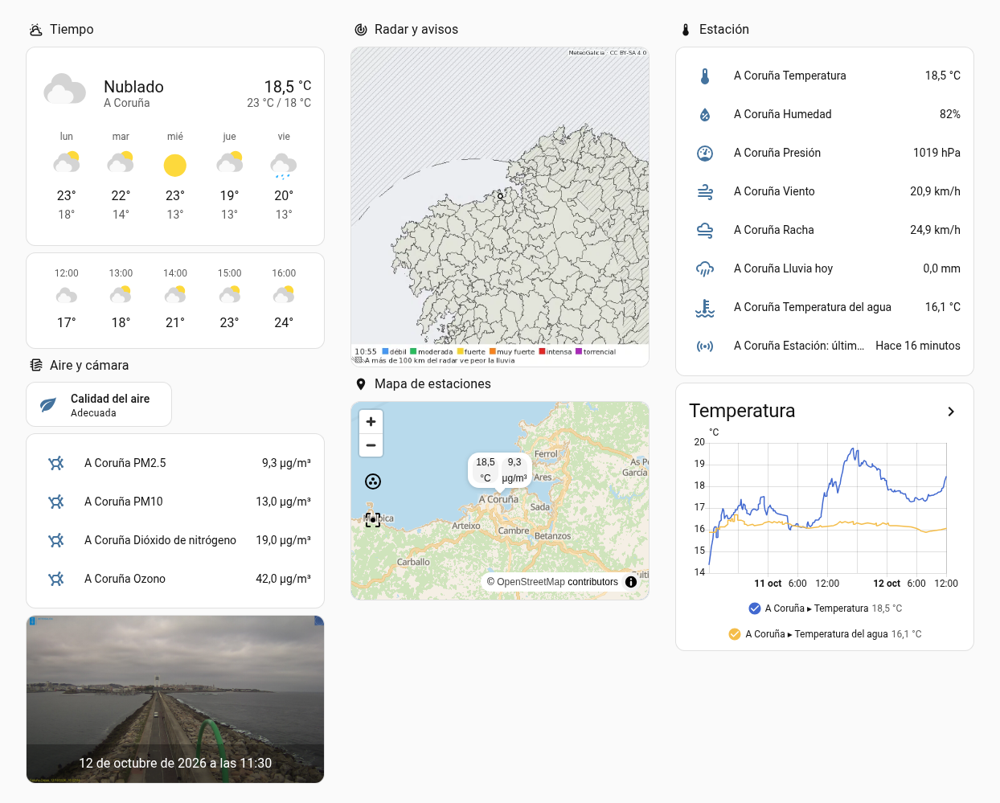
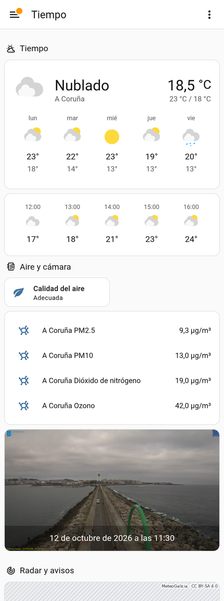

# Panel de ejemplo

Un panel completo con lo que ofrece MeteoGal, listo para copiar. Usa tarjetas estándar de Home Assistant: no necesita tarjetas personalizadas.



En el móvil, las tres columnas pasan a una sola:



Las `entity_id` son las de una ubicación en **A Coruña** con Home Assistant en castellano; **cámbialas por las tuyas** (Ajustes → Entidades, busca «MeteoGal»). Las entidades que no tengas (por ejemplo, sin estación de calidad del aire) simplemente salen como «Entidad no disponible»: borra esas tarjetas.

## Cómo ponerlo

1. Ajustes → Paneles → **Añadir panel** → *Nuevo panel desde cero* (o abre uno existente).
2. Menú ⋮ de arriba a la derecha → **Editor de configuración sin procesar**.
3. Pega el YAML de abajo (en un panel existente, copia solo el bloque `- title: Tiempo …` dentro de `views:`) y guarda. En una vista de secciones, cada bloque `- type: grid` es una columna; puedes mover y redimensionar las tarjetas con el editor.

## El panel

Está hecho con una vista de **secciones** (el formato actual de Home Assistant), en tres columnas y con un encabezado por tema:

```yaml
title: Tiempo en Galicia
views:
  - title: Tiempo
    path: tiempo
    type: sections
    max_columns: 3
    icon: mdi:weather-partly-rainy
    sections:
      # Columna 1: el tiempo, la calidad del aire y la cámara
      - type: grid
        cards:
          - type: heading
            heading: Tiempo
            icon: mdi:weather-partly-cloudy
          # El tiempo ahora y los próximos días
          - type: weather-forecast
            entity: weather.a_coruna
            forecast_type: daily
            show_current: true
            show_forecast: true
          # Por horas
          - type: weather-forecast
            entity: weather.a_coruna
            forecast_type: hourly
            show_current: false
            show_forecast: true
          - type: heading
            heading: Aire y cámara
            icon: mdi:air-filter
          - type: tile
            entity: sensor.a_coruna_calidad_del_aire
            name: Calidad del aire
          - type: entities
            entities:
              - sensor.a_coruna_pm2_5
              - sensor.a_coruna_pm10
              - sensor.a_coruna_dioxido_de_nitrogeno
              - sensor.a_coruna_ozono
          - type: picture-entity
            entity: image.a_coruna_camara
            show_name: false
            show_state: true

      # Columna 2: el radar, los avisos y el mapa de estaciones
      - type: grid
        cards:
          - type: heading
            heading: Radar y avisos
            icon: mdi:radar
          # Se anima solo con las últimas horas
          - type: picture-entity
            entity: image.a_coruna_radar
            show_name: false
            show_state: false
          # Los avisos solo aparecen cuando hay alguno vigente o próximo
          - type: conditional
            conditions:
              - condition: or
                conditions:
                  - condition: state
                    entity: sensor.a_coruna_nivel_de_aviso
                    state_not: none
                  - condition: state
                    entity: sensor.a_coruna_nivel_de_aviso_proximo
                    state_not: none
            card:
              type: markdown
              title: Avisos de MeteoGalicia
              content: |
                
                
                
                **{{ 'Vigente' if loop.first else 'Próximo' }}: aviso {{ state_translated(e) | lower }}**
                por {{ tipos.get(state_attr(e, 'type'), 'otro fenómeno') }},
                {{ as_timestamp(state_attr(e, 'start')) | timestamp_custom('%d/%m %H:%M') }} –
                {{ as_timestamp(state_attr(e, 'end')) | timestamp_custom('%d/%m %H:%M') }}.
                {{ state_attr(e, 'description') or '' }}
                
                
          - type: heading
            heading: Mapa de estaciones
            icon: mdi:map-marker
          # Cada estación aparece donde está la estación, no donde está tu casa
          - type: map
            default_zoom: 9
            entities:
              - entity: sensor.a_coruna_temperatura
                label_mode: state
              - entity: sensor.a_coruna_pm2_5
                label_mode: state

      # Columna 3: lo que se mide en la estación
      - type: grid
        cards:
          - type: heading
            heading: Estación
            icon: mdi:thermometer
          - type: entities
            entities:
              - sensor.a_coruna_temperatura
              - sensor.a_coruna_humedad
              - sensor.a_coruna_presion
              - sensor.a_coruna_viento
              - sensor.a_coruna_racha
              - sensor.a_coruna_lluvia_hoy
              - sensor.a_coruna_temperatura_del_agua
              - sensor.a_coruna_estacion_ultima_medida
          - type: history-graph
            title: Temperatura
            hours_to_show: 48
            entities:
              - sensor.a_coruna_temperatura
              - sensor.a_coruna_temperatura_del_agua
```

## Con clave de MeteoSIX

Si has añadido la [clave de MeteoSIX](../README.md#clave-de-meteosix-opcional), puedes añadir esta tarjeta, que dice cuánto llueve y cuándo vuelve a llover:

```yaml
          - type: entities
            title: Lluvia
            entities:
              - sensor.a_coruna_lluvia_esta_hora
              - sensor.a_coruna_proxima_lluvia
```

Va en cualquiera de las columnas.

## Qué es cada tarjeta

| Tarjeta | Entidades | Más información |
|---|---|---|
| Tiempo (diaria y por horas) | `weather.<ubicación>` | [El tiempo](../README.md#el-tiempo) |
| Radar | `image.<ubicación>_radar` | [Radar](../README.md#radar) |
| Avisos | `sensor.<ubicación>_nivel_de_aviso` y `…_nivel_de_aviso_proximo` | [Avisos](../README.md#avisos) |
| Estación y temperatura | Sensores de la estación | [Estación](../README.md#estación) |
| Calidad del aire | `sensor.<ubicación>_calidad_del_aire` y los contaminantes de la estación de aire | [Calidad del aire](../README.md#calidad-del-aire) |
| Cámara | `image.<ubicación>_camara` | [Cámara](../README.md#cámara) |
| Mapa | Sensores de estación (llevan `latitude` y `longitude`) | [Estación](../README.md#estación) |

**La racha prevista** (`wind_gust_speed`, del modelo WRF de 4 km, sin clave) no la muestra la tarjeta estándar del tiempo, pero está en la previsión por horas y por días de la entidad: se usa en plantillas, automatizaciones y tarjetas del tiempo personalizadas. Hay un [ejemplo](../README.md#ejemplos). La racha **medida** en la estación sí sale en la tarjeta «Estación».
